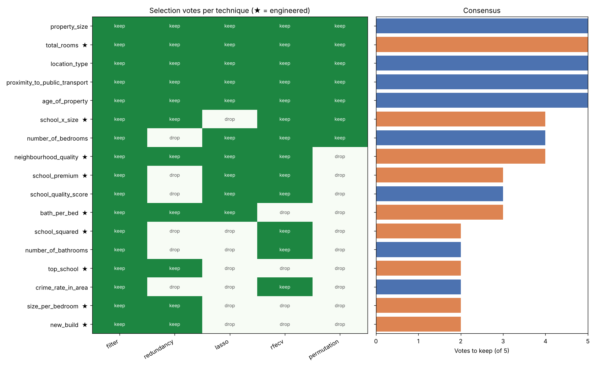
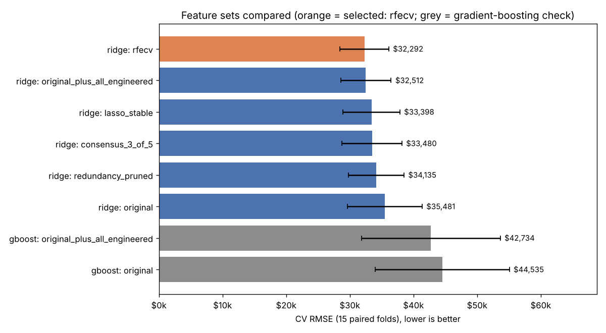
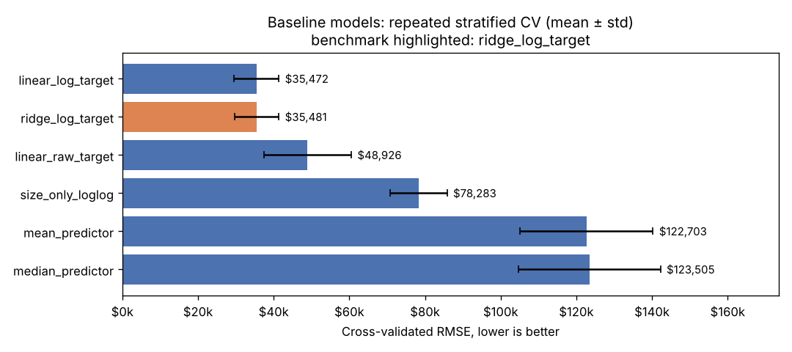
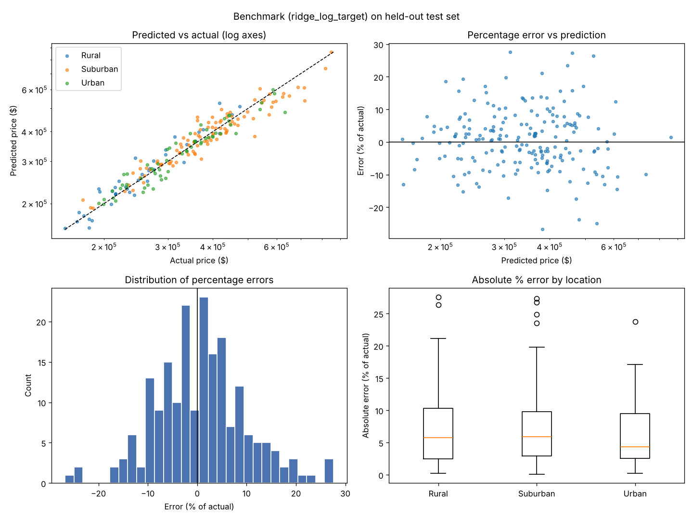
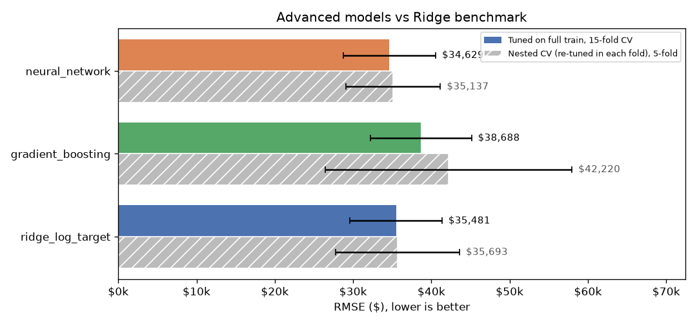
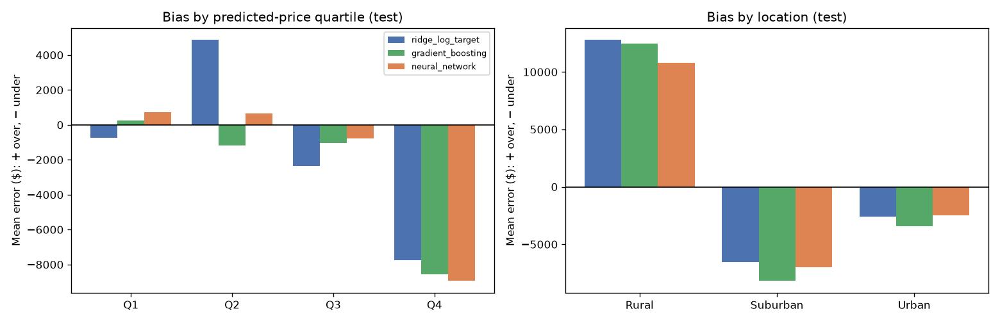
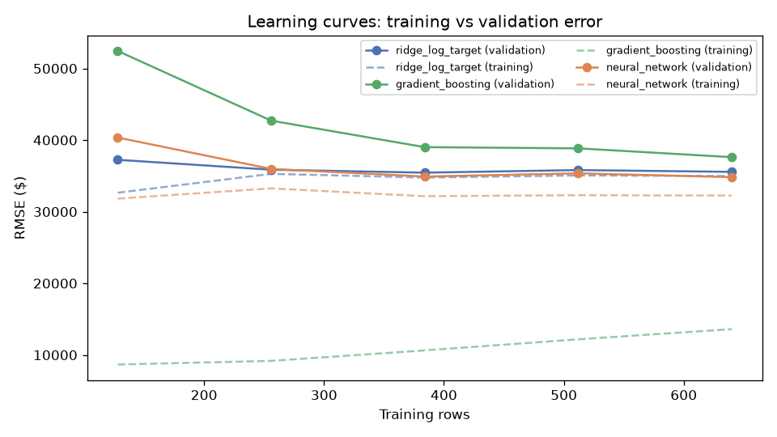
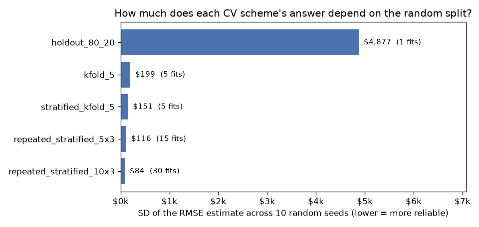
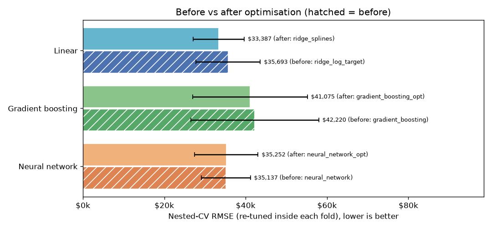
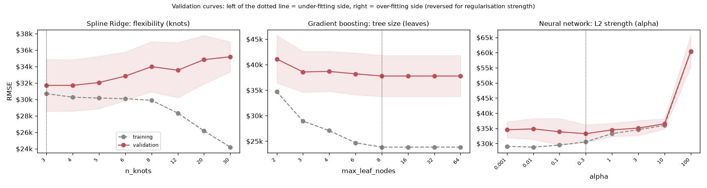

# House Sale Price — EDA, Preprocessing, Modelling & Optimisation

A **regression** project: predicting `house_sale_price` from property and neighbourhood attributes.

- **Stage 1 — EDA** (`eda.ipynb`): understand the data and decide how to prepare it.
- **Stage 2 — Preprocessing pipeline** (`src/preprocessing.py`, `main.py`): a modular, reusable scikit-learn pipeline that
  implements those decisions for missing values, outliers, transformation, encoding and scaling.
- **Stage 2b — Feature engineering** (`src/feature_engineering.py`, `main.py --stage features`): nine domain-driven
  features, five feature-selection techniques and a paired-CV comparison of feature sets. **Selected set: RFECV**
  (original features + 5 engineered), CV RMSE −9.0% for the Ridge benchmark.
- **Stage 3 — Baseline model** (`src/models.py`, `main.py`): a ladder of baseline models, a shared evaluation framework
  and a saved benchmark (`benchmark.json`) that every later model must beat.
- **Stage 4 — Advanced models** (`src/advanced_models.py`, `main.py`): gradient boosting and a neural network, tuned and
  compared against the benchmark with paired and nested cross-validation.
- **Stage 5 — Model optimisation** (`src/model_optimization.py`, `main.py`): cross-validation strategy, hyperparameter
  tuning of every model family, and targeted fixes for under-fitting, over-fitting and instability. **Final model:
  `ridge_splines`** (nested-CV RMSE −6.5% vs the Ridge benchmark).

> The original brief referred to "the None problem" — an unfilled template placeholder. This project treats the task as
> house sale price regression, which is what the dataset supports.

## Repository structure

```
AIFC_Capstone/
├── README.md                 # This file: setup, EDA findings, pipeline docs
├── eda.ipynb                 # Full EDA notebook (executed, outputs included)
├── requirements.txt          # Python dependencies
├── main.py                   # Runs preprocessing + baseline modelling end to end (CLI)
├── src/
│   ├── preprocessing.py      # Reusable preprocessing module (config, transformers, pipeline)
│   ├── feature_engineering.py # Domain features, feature selection, feature-set comparison
│   ├── models.py             # Baseline models, metrics, CV, model comparison, benchmark
│   ├── advanced_models.py    # Gradient boosting + neural network, tuning, nested CV, analysis
│   └── model_optimization.py # CV strategies, tuning, over/under-fitting fixes, final model selection
├── docs/                     # Plots shown in this README
└── synthetic_data_208.csv    # Dataset (1,000 rows × 9 columns)
```

## Setup (VS Code)

```bash
git clone https://github.com/giddyup171/AIFC_Capstone.git
cd AIFC_Capstone
python -m venv .venv
# macOS/Linux: source .venv/bin/activate     Windows: .venv\Scripts\activate
pip install -r requirements.txt
code .
```

In VS Code, install the **Python** and **Jupyter** extensions, open `eda.ipynb`, choose the `.venv` interpreter as the kernel,
and select **Run All**. The notebook expects `synthetic_data_208.csv` in the repo root.

To run the preprocessing pipeline, open a terminal in the repo root (**Terminal → New Terminal**) and run:

```bash
python main.py
```

## Dataset

| Column | Type | Description |
|---|---|---|
| `property_size` | float | Floor area (≈ 980 – 11,546) |
| `number_of_bedrooms` | float | Bedrooms (1.02 – 6.0, fractional) |
| `number_of_bathrooms` | float | Bathrooms (1.16 – 10.82, fractional) |
| `location_type` | category | Suburban (500), Urban (300), Rural (200) |
| `age_of_property` | float | Years (0.5 – 85.5) |
| `proximity_to_public_transport` | float | 0.006 – 11.45 — **units/meaning unconfirmed** |
| `crime_rate_in_area` | float | 0.6 – 40.7 |
| `school_quality_score` | float | 1.6 – 9.9 |
| `house_sale_price` | float | **Target**, $102k – $1.38M, median $330k |

## Key EDA findings

### 1. The data is close to multiplicative — this is the headline result
A plain linear regression on **log(price)** with log-transformed skewed features reaches **≈ 0.93 cross-validated R²**
(RMSE ≈ $35.9k), versus 0.87 R² (RMSE ≈ $44.4k) on raw scales and 0.90 for an untuned random forest. The generating process
is approximately `log(price) ≈ β₀ + 0.48·log(size) + 0.085·school + … + location offset`. Getting the transform right matters
far more than model complexity or feature invention.

### 2. Data quality
| Issue | Evidence | Action |
|---|---|---|
| Missing values | None | No imputation needed (keep an imputer in the pipeline for safety) |
| Duplicates | 0 | None |
| Fractional bedroom/bathroom counts | 99% non-integer | Keep continuous; will not transfer to real integer data |
| Bedroom ceiling | 4 rows exactly at 6.0 | Treat as censored; minor impact |
| `proximity_to_public_transport` meaning | Correlates **positively** with price | Confirm whether it is a distance or a score before interpreting |
| Designed category split | Exactly 500 / 300 / 200 | Stratify the train/test split on `location_type` |

### 3. Distributions
- Target skew 1.63 → 0.11 after log (normality not rejected after log, p = 0.13).
- Right-skewed features: crime (2.3), size (2.0), proximity (1.7), age (1.2), bathrooms (1.1).
- `school_quality_score` is left-skewed — do **not** log it.
- Most raw IQR "outliers" vanish on the log scale (e.g. crime 56 → 5). Max Cook's distance ≈ 0.03 → **no rows removed**.

### 4. Drivers of price
- **`property_size`** dominates: elasticity ≈ 0.48 (doubling size ≈ +39% price).
- **`school_quality_score`** is the strongest neighbourhood factor: +1 point ≈ +8.8% price.
- **Location** is a level shift, not a slope change: after controls, Suburban ≈ +8% and Urban ≈ +3% vs Rural.
  Raw medians: Suburban $374k > Urban $297k > Rural $265k (Urban below Suburban — don't assume an urban premium).
- **Crime** looks strong marginally (Spearman −0.43) but its conditional effect is small; it is largely explained by school
  quality and location.
- **Bathrooms** add nothing once size and bedrooms are in the model (p = 0.57).
- Multicollinearity is moderate (all VIF < 2.4).

### 5. Feature engineering
Ratios (`size_per_bedroom`, `bath_per_bed`), `school/crime`, and size × location interactions improved CV R² by ≤ 0.002.
Keep the feature set small.

## Recommended preprocessing pipeline (from EDA)
1. Stratified train/test split on `location_type`; fit every transform on train only.
2. Log-transform the target and `property_size`, `crime_rate_in_area`, `proximity_to_public_transport`, `age_of_property`.
3. One-hot encode `location_type`.
4. Standardise numeric features for regularised linear models.
5. Baseline: Ridge on log-log features. Challengers: LightGBM / XGBoost — they must beat the baseline on CV to be worth it.
6. Report RMSE / MAE in dollars and MAPE after back-transforming; apply Duan's smearing correction if mean prices are needed.

## Preprocessing pipeline

### Design: every step traces back to an EDA finding

```
raw DataFrame
  └─ DomainValidator          coerce types, impossible values → NaN, normalise categories   (stateless rules)
  └─ ColumnTransformer
       ├─ numeric   : SimpleImputer(median) → LogTransformer → OutlierCapper → StandardScaler
       └─ category  : SimpleImputer(most_frequent) → OneHotEncoder(fixed categories, drop first)
target: log(price), back-transformed with exp × Duan smearing factor
```

| Concern | Strategy | Why (EDA evidence) |
|---|---|---|
| **Missing values** | Median imputation for numeric, mode for `location_type`; parameters learned on train only | Dataset has 0 missing, so this is a **safety net** for new data. Median, not mean, because 5 of 7 numeric features are right-skewed |
| **Invalid values** | `DomainValidator` turns impossible values into NaN before imputation: size/bedrooms/bathrooms ≤ 0, negative age/distance/crime, school score outside 0–10, non-numeric text, ±inf, unknown locations | Catches data-entry errors at both training and prediction time instead of letting them distort the model |
| **Outliers** | **No rows removed.** Log-transform skewed features, then cap values beyond 3 × IQR (Tukey "far out" fences) on the log scale, with bounds learned on train | Raw IQR "outliers" are the tail of log-normal distributions and mostly vanish after log (crime 56 → 5); max Cook's D ≈ 0.03, so no point is erroneous or dominant |
| **Skewness** | `log` for `property_size`, `crime_rate_in_area`, `proximity_to_public_transport`, `age_of_property`, and the target | Log-log form gives CV R² 0.93 vs 0.87 raw. `school_quality_score` is left-skewed and not logged |
| **Normalisation** | `StandardScaler` (configurable: `robust`, `minmax`, `none`) | Puts features on a comparable scale for regularised linear models; trees can use `none` |
| **Encoding** | One-hot `location_type` with fixed categories `Rural/Suburban/Urban`, first level dropped, unseen levels ignored | 3 levels only; fixed categories keep columns identical across train, test and new data |
| **Splitting** | Train/test split stratified on `location_type` | Category mix is a fixed 50/30/20 by design |
| **Leakage** | Every learned value (medians, log floors, caps, scaler stats) is fitted on the training split only | Test performance stays an honest estimate |

### Modular and reusable
- `PreprocessingConfig` — one dataclass holds every setting; experiments change config, not code.
- `DomainValidator`, `LogTransformer`, `OutlierCapper` — scikit-learn compatible transformers that can be reused in other
  pipelines.
- `build_preprocessor(config)` — returns an unfitted `Pipeline` that can be the first step of any model pipeline:
  ```python
  from sklearn.pipeline import Pipeline
  from sklearn.linear_model import Ridge
  from src.preprocessing import build_preprocessor
  model = Pipeline([("prep", build_preprocessor()), ("ridge", Ridge())])
  ```
- `HousePricePreprocessor` — wrapper with `fit`, `transform`, `fit_transform`, target transforms, `save` / `load` (joblib),
  so the exact fitted pipeline can be reused for inference:
  ```python
  from src.preprocessing import HousePricePreprocessor
  prep = HousePricePreprocessor.load("artifacts/preprocessor.joblib")
  X_new_ready = prep.transform(new_listings_df)
  ```
- New data can arrive with columns in any order or with extra columns (IDs, the target); only the required features are used.
  A missing required column raises a clear error.

### Running it

```bash
python main.py --stage preprocess                              # preprocessing only
python main.py --scaler robust --outlier-method quantile       # alternative strategies
python main.py --drop-features number_of_bathrooms             # drop a feature
python main.py --help                                          # all options
```

Outputs are written to `artifacts/` (not committed; regenerate with `python main.py`):

| File | Contents |
|---|---|
| `X_train.csv`, `X_test.csv` | Model-ready features |
| `y_train.csv`, `y_test.csv` | Log-price (`y`) and original price (`price`) |
| `preprocessor.joblib` | Fitted pipeline for reuse on new data |
| `preprocessing_report.json` | Config, data-quality counts, learned parameters, baseline and robustness results |

### Results of a default run

```
INFO | Loaded 1000 rows x 9 columns from synthetic_data_208.csv
INFO | Missing values (raw): 0
INFO | Invalid values converted to missing: 0
INFO | Cleaning: {'rows_in': 1000, 'duplicates_removed': 0, 'invalid_target_removed': 0, 'rows_out': 1000}
INFO | Split: train=800 test=200
INFO | Output features (9): ['property_size', 'number_of_bedrooms', 'number_of_bathrooms', 'age_of_property', 'proximity_to_public_transport', 'crime_rate_in_area', 'school_quality_score', 'location_type_Suburban', 'location_type_Urban']
INFO | Values capped in training: {'number_of_bathrooms': 2}
INFO | Robustness check on corrupted test data: PASSED
```

**Built-in checks**
- **Robustness check:** `main.py` corrupts a copy of the test set with the problems the pipeline claims to handle (10% missing
  sizes, missing and unseen categories such as `"Coastal"`, messy text like `"  urban "`, negative bedrooms, school score 47,
  a 5,000,000 sq ft house, zero age before log, and text like `"three"` in a numeric column). The fitted pipeline must return
  the same shape with all-finite values, or the run fails.

### Strategy comparison (test set, Ridge on processed features)

| Configuration | R² | RMSE | MAPE |
|---|---|---|---|
| **Default** (log target, IQR capping, standard scaler) | **0.911** | **$37,765** | **7.1%** |
| No outlier capping | 0.911 | $37,756 | 7.1% |
| Quantile capping (0.5% / 99.5%) | 0.911 | $37,878 | 7.1% |
| Robust scaler | 0.911 | $37,765 | 7.1% |
| Drop `number_of_bathrooms` | 0.911 | $37,782 | 7.1% |
| **Raw-scale target (no log)** | 0.862 | $47,142 | 9.3% |

The only choice that matters on this dataset is the **log transform of the target**. Removing it costs about $9,400 of RMSE.
Outlier capping and scaler choice change almost nothing here because the data is clean. They are kept as safeguards for
noisier future data, where the robustness check shows they matter.

## Feature engineering (Stage 2b)

Run on its own with `python main.py --stage features` (about 30 seconds); it is also part of `python main.py`.

### Engineered features and their domain rationale

`DomainFeatureEngineer` builds these **inside** the scikit-learn pipeline (after validation, before imputation), so they
are recomputed identically for new data and re-fitted in every CV fold with no leakage.

| Feature | Formula | Domain rationale |
|---|---|---|
| `school_premium` | exp(school / 3) | Buyers pay disproportionately more for the best school catchments. A diagnostic run for this stage showed that almost all of Stage 5's spline gain comes from curvature in the school effect (splines on school alone recover $2,467 of the $2,592 gain) |
| `school_squared` | school² | Simpler encoding of the same curvature; included so selection can choose between them |
| `neighbourhood_quality` | log(school / crime) | Good schools and low crime describe one thing to a buyer: a desirable area |
| `size_per_bedroom` | size / bedrooms (logged) | Spaciousness: larger rooms signal a higher-end home |
| `bath_per_bed` | bathrooms / bedrooms | En-suite ratio, a common luxury indicator |
| `total_rooms` | bedrooms + bathrooms | Overall size in rooms, a standard listing figure |
| `school_x_size` | school × log(size) | Families buying large homes may value schools more |
| `top_school` | 1 if school ≥ 8.5 | Step premium for top-rated catchments |
| `new_build` | 1 if age < 5 | New-build premium |

**Engineering pitfall found and handled:** Stage 2's IQR outlier capper collapses to [0, 0] for a mostly-zero 0/1
column and silently erased the two flags in a first test (they changed the model by exactly $0). Binary features now
bypass the capper and are only imputed.

### Feature selection: five techniques

All run on the training set only, on the processed design matrix (log target). Each casts a keep/drop vote:

| Technique | Type | Keep rule |
|---|---|---|
| Mutual information | Filter (univariate relevance) | MI ≥ 0.01 |
| Spearman redundancy | Filter (redundancy) | Not the weaker member of a pair with \|ρ\| ≥ 0.9 |
| Lasso stability | Embedded | Non-zero LassoCV coefficient in ≥ 80% of the 15 CV folds |
| RFECV with Ridge | Wrapper | Kept by recursive elimination with 5-fold CV |
| Permutation importance (gradient boosting) | Model-agnostic | Shuffling raises RMSE by > 0.2% of mean price |



What the techniques show:
- **Redundancy is real.** The school encodings are rank-identical to the raw score (ρ = 1.0), `total_rooms` overlaps
  bedrooms (0.93) and bathrooms (0.92), and `neighbourhood_quality` overlaps crime (0.96).
- **Techniques disagree for good reasons.** Permutation importance gives `school_premium`/`school_squared` zero,
  because a tree treats any monotonic transform of school as the same feature. Lasso and RFECV keep them, because a
  linear model *can* only use the curvature if it is given as a feature.
- **Two ideas fail:** `top_school` and `new_build` get only 2 of 5 votes (the effects are smooth, not steps), and
  `size_per_bedroom` adds nothing once size and rooms are known.

### Comparing feature sets

Six candidate sets, built from the votes, were compared with the Ridge benchmark on **the same 15 paired folds as
Stage 3**, with gradient boosting as a check that the gain is not specific to linear models:



| Feature set (Ridge) | Features | CV RMSE | vs original | Folds better | p-value |
|---|---|---|---|---|---|
| Original (Stage 2) | 8 | $35,481 | — | — | — |
| **RFECV (selected)** | **13** | **$32,292** | **−9.0%** | **15/15** | **0.0008** |
| Original + all 9 engineered | 17 | $32,512 | −8.4% | 15/15 | 0.001 |
| Lasso-stable | 10 | $33,398 | −5.9% | 14/15 | 0.0002 |
| Consensus (≥ 3 of 5 votes) | 11 | $33,480 | −5.6% | 14/15 | 0.0001 |
| Redundancy-pruned | 11 | $34,135 | −3.8% | 12/15 | 0.01 |

**Selection rule** (in `choose_feature_set`, fixed before the comparison): a set must beat the original features on the
paired folds (p < 0.05) by at least 0.5%; among those, the sets within 0.5% of the best are tied and the one with fewest
features wins. RFECV was best by more than 0.5%, so no tie applied.

**Selected: the original 8 features + `school_premium`, `school_squared`, `neighbourhood_quality`, `total_rooms`,
`school_x_size`.**

| Held-out test set (Ridge) | RMSE | MAE | MAPE | R² |
|---|---|---|---|---|
| Original features | $37,783 | $26,411 | 7.12% | 0.911 |
| **Selected features** | **$36,559** | **$25,178** | **6.74%** | **0.917** |

### What it means
1. **Domain features help.** The Ridge benchmark improves by 9% in CV and 3.2% on the test set, and gradient boosting
   also improves (−4.0% CV RMSE with all engineered features), so the gain is not a linear-model artefact.
2. **It is the same signal Stage 5 found, now with names.** The engineered Ridge (CV $32,292) matches the Stage 5
   spline Ridge (CV $32,391): both capture the curved school effect. Here it is expressed as features a buyer or
   valuer can understand ("school premium", "neighbourhood quality") instead of spline basis functions.
3. **More features ≠ better.** Adding all nine is worse than the RFECV subset, and the pruned sets that removed the
   original school/crime columns lost accuracy: the engineered features complement the raw ones rather than replace them.
4. **Caveat:** the selected set keeps three highly correlated school encodings. Ridge's penalty handles the collinearity
   for prediction, but individual coefficients of those three should not be interpreted on their own.

**How this relates to Stages 3–5:** those stages were built and reported on the original 8 features, and their results are
kept unchanged so they stay comparable with each other. The Stage 5 final model (`ridge_splines`) already captures the
same curvature, so its conclusion stands. For a next iteration, the selected feature set can be plugged into any model with
`make_fe_model(regressor, engineered=[...])`.

Outputs in `artifacts/features/`: `engineered_feature_catalogue.csv` (formulas and rationale),
`feature_selection_scores.csv` (all techniques and votes), `redundant_pairs.csv`, `feature_set_comparison.csv`,
`feature_set_cv_folds.csv`, `feature_set_test.csv`, `selected_features.json` (decision, rule, selected set) and plots.

## Baseline model

### Why a ladder of baselines
A single baseline number means little on its own. `src/models.py` trains six models of increasing sophistication, each one
a full `Pipeline(preprocess → regressor)`, so every gain can be attributed to one change:

| Model | What it is | What it tests |
|---|---|---|
| `mean_predictor` | Predicts the training mean for every house | The floor any model must clear |
| `median_predictor` | Predicts the training median | Robust naive floor |
| `size_only_loglog` | log(price) ~ log(size) | How far the single strongest EDA driver gets |
| `linear_raw_target` | OLS on all features, dollar target | Value of the full feature set without the log target |
| `linear_log_target` | OLS on all features, log target + smearing | Value of the log target recommended by the EDA |
| **`ridge_log_target`** | **RidgeCV (alpha tuned by internal CV), log target** | **The benchmark** |

Ridge is the declared benchmark because it is the EDA's recommended model and its regularisation stays stable as features
are added in later stages. Log-target models predict `exp(ŷ) × smearing factor` (Duan, 1983) so dollar predictions estimate
the mean rather than the median.

### Evaluation design
- **Metrics (all in dollars on the original scale):** RMSE is the **primary metric** because it penalises large misses on
  expensive homes. MAE (typical error), MAPE (relative error, comparable across price levels), R², RMSLE (matches the log
  training scale), median AE, max error and bias (systematic over/under-prediction) are reported alongside it.
- **Cross-validation:** 5-fold × 3 repeats (15 folds), stratified by `location_type`, on the **training set only**. The same
  fold indices are reused for every model, so comparisons are paired.
- **No leakage:** preprocessing is re-fitted inside every fold because it is part of each model's pipeline.
- **Held-out test set (200 rows):** touched once, after CV, to confirm the CV estimate.
- **Improvement rule (`compare_models`):** a new model only counts as better if its mean CV RMSE is lower on the same folds
  **and** a paired t-test across folds gives p < 0.05.
- **Error breakdown:** per location and per predicted-price quartile, to show where the model fails rather than only how much.

### Results



| Model | CV RMSE (mean ± std) | CV MAE | CV MAPE | CV R² | RMSE cut vs mean | Test RMSE | Test R² |
|---|---|---|---|---|---|---|---|
| linear_log_target | $35,472 ± 5,897 | $25,062 | 7.1% | 0.915 | 71.1% | $37,742 | 0.911 |
| **ridge_log_target** | **$35,481 ± 5,875** | **$25,059** | **7.1%** | **0.915** | **71.1%** | **$37,783** | **0.911** |
| linear_raw_target | $48,926 ± 11,569 | $33,155 | 10.3% | 0.841 | 60.1% | $46,896 | 0.863 |
| size_only_loglog | $78,283 ± 7,525 | $57,966 | 17.3% | 0.577 | 36.2% | $75,938 | 0.641 |
| mean_predictor | $122,703 ± 17,538 | $91,492 | 29.9% | −0.012 | 0.0% | $127,552 | −0.012 |
| median_predictor | $123,505 ± 18,714 | $90,702 | 28.3% | −0.023 | −0.7% | $130,197 | −0.054 |

**Paired comparisons (RMSE, same 15 folds)**

| Step up the ladder | RMSE change | Folds won | p-value | Significant |
|---|---|---|---|---|
| size_only_loglog vs mean_predictor | −$44,420 | 15/15 | 1e-09 | yes |
| linear_log_target vs size_only_loglog | −$42,812 | 15/15 | 2e-15 | yes |
| linear_log_target vs linear_raw_target | −$13,455 | 15/15 | 6e-07 | yes |
| ridge_log_target vs linear_log_target | +$9 | 6/15 | 0.43 | no |

**Benchmark: `ridge_log_target` — CV RMSE $35,481 ± $5,875, CV R² 0.915, test RMSE $37,783, test R² 0.911, MAPE 7.1%.**
These numbers are saved in `artifacts/models/benchmark.json` as the score to beat.

### What the baseline tells us
1. **The baseline is already strong.** It removes 71% of the naive model's error, and the test score agrees with CV
   (0.911 vs 0.915), so the CV estimate can be trusted.
2. **The log target is worth about $13,500 of RMSE** and wins on every fold, confirming the EDA's main recommendation.
3. **Regularisation adds nothing here** (ridge vs OLS: +$9, p = 0.43). With 9 features, 800 rows and VIFs below 2.4 there is
   nothing to shrink. Ridge is kept as the benchmark for stability when features are added later, but OLS is statistically tied.
4. **Errors are unbiased across price levels and locations.** *Correction made in Stage 4:* the first version of this
   section reported under-prediction of expensive homes (−$26k) and over-prediction of Rural homes (+$13k). Both were
   artifacts. The price bands were formed on the **actual** price, which selects on the outcome (regression to the mean);
   grouped by **predicted** price, out-of-fold bias is within ±$3k (< 1%) in every quartile. The Rural figure came from only
   40 test rows; across all 800 training rows out-of-fold, Rural bias is +$2.2k ± $2.0k (not significant). Errors grow in
   dollars with price (RMSE $19k in the cheapest predicted quartile vs $60k in the most expensive), but stay near 6–9% in
   relative terms, as expected for multiplicative noise.
5. **Coefficients** (standardised inputs, log target; exp(b) − 1 ≈ % price change per 1 SD): property size +21%, school
   quality +15%, Suburban vs Rural +7%, bedrooms +6%, proximity +5%, age −3%, crime −1.5%, bathrooms ≈ 0 — consistent
   with the EDA.



### Using it to compare future models

```python
from sklearn.ensemble import GradientBoostingRegressor
from src.models import make_model, get_baseline_models, make_cv_splits, cross_validate_models, compare_models

models = get_baseline_models()
models["gbr"] = make_model(GradientBoostingRegressor(random_state=42))   # same preprocessing, log target
splits = make_cv_splits(X_train)                                         # identical folds for everyone
folds = cross_validate_models(models, X_train, y_train, splits)
print(compare_models(folds, baseline="ridge_log_target", candidate="gbr"))
```

Reuse the saved benchmark model on new data (it includes the preprocessing):

```python
from src.models import load_model
model = load_model("artifacts/models/baseline_model.joblib")
prices = model.predict(new_listings_df)    # raw columns in, dollar predictions out
```

### Baseline outputs (`artifacts/models/`)

| File | Contents |
|---|---|
| `baseline_leaderboard.csv` | CV mean/std and test score for every metric and model |
| `cv_fold_results.csv` | Every metric for every model on every fold (for paired comparisons) |
| `benchmark.json` | Score to beat, improvement rule, paired comparisons, settings and versions |
| `baseline_model.joblib` | Fitted benchmark pipeline (preprocessing + Ridge) |
| `benchmark_errors_by_location.csv`, `benchmark_errors_by_price_band.csv` | Error breakdowns |
| `benchmark_coefficients.csv` | Benchmark coefficients |
| `cv_rmse_comparison.png`, `benchmark_diagnostics.png` | Plots (copies in `docs/` for this README) |

## Advanced models

### Why these two architectures
The benchmark assumes price is linear in log-transformed features. The two advanced models each drop that assumption in a
different way:

| Model | Architecture | What it can learn that Ridge cannot | Setup |
|---|---|---|---|
| `gradient_boosting` | `HistGradientBoostingRegressor`, an ensemble of shallow decision trees fitted sequentially to residuals | Thresholds, interactions and any non-linear shape, with no assumption about functional form | Log target with smearing; no scaling (trees don't need it); optional **monotonic constraints from the EDA** (price rises with size, school quality and bedrooms, falls with crime and age) |
| `neural_network` | `MLPRegressor`, a feed-forward neural network trained with L-BFGS | Smooth non-linear functions of all features combined | Log target with smearing; standardised inputs from the Stage 2 pipeline; L2 penalty `alpha` tuned to stop it memorising 800 rows. L-BFGS is used because it converges better than Adam/SGD on small data |

Both reuse the Stage 2 preprocessing and the Stage 3 log-target wrapper, so any difference in results comes from the model
alone.

### Tuning and evaluation
1. **Tuning:** randomised search (20 trials, 5-fold inner CV, training set only) over learning rate, trees, leaves,
   leaf size, L2, feature sampling and monotonic constraints (boosting), and over hidden layers, activation and L2
   strength (neural network).
2. **Paired CV:** the tuned models are scored on **the same 15 folds as the baselines**, so `compare_models` gives a paired
   test against Ridge.
3. **Nested CV:** step 2 is optimistic because the hyperparameters were chosen on the same training data. Nested CV
   re-runs the whole search inside each of 5 outer folds, so the outer score never sees tuning data. This is the unbiased
   estimate.
4. **Held-out test set**, bias by predicted-price quartile and by location, permutation importance (model-agnostic),
   fit/predict time and learning curves.
5. **Decision rule:** a model replaces the benchmark only if it wins significantly on the paired folds **and** has lower
   nested-CV RMSE.

Selected hyperparameters (submission run, Windows): boosting used the EDA monotonic constraints, 620 trees, learning rate
0.016, 27 leaves; the neural network chose one hidden layer of 64 tanh units with `alpha` = 0.56 (strong regularisation).

### Results

These are the results of the submission run (Windows 11, Anaconda Python 3.11, scikit-learn 1.9.0, NumPy 2.4.6), which is
what `python main.py` reproduces on that machine. The next section explains why another platform gives a different verdict.



| Model | CV RMSE (15 folds) | **Nested CV RMSE** | CV MAE | CV MAPE | CV R² | Test RMSE | Test MAPE | Test R² |
|---|---|---|---|---|---|---|---|---|
| ridge_log_target (benchmark) | $35,481 ± 5,875 | $35,693 | $25,059 | 7.1% | 0.915 | $37,783 | 7.1% | 0.911 |
| gradient_boosting | $38,688 ± 6,437 | $42,220 | $26,927 | 7.6% | 0.899 | $36,754 | 7.3% | 0.916 |
| **neural_network** | **$34,629 ± 5,915** | **$35,137** | **$24,305** | **6.9%** | **0.919** | **$35,034** | **6.7%** | **0.924** |

| Paired comparison (RMSE) | Difference | Folds won | p-value |
|---|---|---|---|
| gradient_boosting vs ridge (15 folds) | +$3,207 | 0/15 | 8e-05 (significantly **worse**) |
| neural_network vs ridge (15 folds) | −$851 | 10/15 | 0.043 (significant) |
| neural_network vs gradient_boosting (15 folds) | −$4,058 | 15/15 | 2e-05 |
| gradient_boosting vs ridge (nested, 5 folds) | +$6,527 | 0/5 | 0.14 |
| neural_network vs ridge (nested, 5 folds) | −$556 | 3/5 | 0.68 (not significant) |

**Decision (rule from "Tuning and evaluation"): `neural_network` replaces `ridge_log_target`.** It wins significantly on
the 15 paired folds (p = 0.043) and has a lower nested-CV RMSE ($35,137 vs $35,693).

### The verdict depends on the platform

The same code with the **same library versions** was also run on Linux (Python 3.13, OpenBLAS). Ridge and gradient
boosting gave identical numbers to the dollar, but the neural network did not:

| Neural network | Windows (submission) | Linux |
|---|---|---|
| Tuned architecture | 64 tanh units, `alpha` 0.56 | 16 ReLU units, `alpha` 0.24 |
| CV RMSE (15 folds) | $34,629 | $34,140 |
| vs Ridge, 15 folds | −$851, p = 0.043 | −$1,341, p = 0.088 |
| Nested CV RMSE | $35,137 | $36,501 |
| vs Ridge, nested | −$556, 3/5 folds, p = 0.68 | +$808, 2/5 folds, p = 0.49 |
| Test RMSE | $35,034 | $36,832 |
| Decision | neural_network selected | ridge_log_target kept |

**Why:** the network is trained by numerical optimisation from random starting weights. Different linear-algebra libraries
(Intel MKL in Anaconda on Windows, OpenBLAS on Linux) round floating-point arithmetic slightly differently. That sends
L-BFGS to a different local minimum, which changes which hyperparameters win the search. Ridge has a closed-form solution
and boosting's tree splits are exact comparisons, so neither is affected.

**What it means:** the network's advantage over Ridge is real on average but small, about $500–850 (1.5–2.5%), and smaller
than the noise between platforms. The decision rule is applied as written, and on the submission machine it selects the
network. But a verdict that flips with the maths library is not robust. In practice the two models are **tied**, and the
choice should rest on secondary criteria (see the conclusion).

### Analysis of relative performance

1. **Most of the network's 15-fold advantage is tuning optimism.** Scored on the folds its hyperparameters were chosen on,
   it beats Ridge by $851. Under nested CV, where tuning never sees the scoring data, the gap shrinks to $556 and is far
   from significant (p = 0.68, 3 of 5 folds). On Linux it reverses. The decision rule only asks that nested RMSE be
   *lower*, not significantly lower, which is why a $556 difference was enough. This is a lesson for future stages: the
   unbiased (nested) comparison should also need significance or a minimum effect size. The rule was **not** changed after
   seeing these results, because changing it to keep Ridge would be choosing the method to fit the answer.
2. **Gradient boosting is clearly worse on every platform.** It loses all 15 paired folds by $3,207 on average and by
   $6,527 under nested CV, with the widest spread between folds. The learning curves show why: training RMSE ≈ $13.6k vs
   validation ≈ $37.6k, so it memorises noise (high variance). Its validation error is still falling at 640 rows, so far
   more data might close the gap, but the true relationship is smooth, and step-shaped trees approximate smooth curves
   inefficiently.
3. **Don't trust the test set alone.** On the 200-row test set the network beats Ridge by $2,749 on Windows but only by
   $951 on Linux, and boosting beats Ridge by $1,029 although it loses every CV fold. Test-set gaps of this size are well
   inside the fold-to-fold spread (~$6,000), which is why the decision uses paired and nested CV.
4. **Ridge has reached the noise floor.** Its training and validation RMSE are both ≈ $35k and flat from 256 rows onward
   (see learning curves). When a simple model's training error equals its validation error and more data does not help,
   the remaining error is noise these features cannot explain. That caps what any architecture can gain, and it is why
   the best case for the network is about 2%.
5. **All three models agree on what matters.** Permutation importance (test RMSE increase when a feature is shuffled):
   size ≈ $71–72k, school quality ≈ $39–43k, bedrooms $11–17k, proximity $10–12k, location $5–6k, age $4–6k,
   crime ≈ $1k, bathrooms ≈ $0–1.4k. The non-linear models found no hidden driver the linear model missed. They lean
   slightly more on bedrooms and bathrooms, consistent with picking up noise in correlated size variables.
6. **Where the network gains, it gains at the edges.** By predicted-price quartile, its test RMSE is lower than Ridge's in
   the cheapest (Q1: $15.4k vs $18.8k) and most expensive (Q4: $53.2k vs $60.0k) bands and similar in between, so its
   small edge comes from mild curvature at the extremes. Bias is near zero for all three models in every band, so no
   model fixes a systematic error the others have.
7. **Cost and interpretability.** Fit time: Ridge 0.04 s, network 0.67 s (17×), boosting 1.76 s (45×). Only Ridge has
   directly readable coefficients and gives identical results on every machine.




### Conclusion
- **Gradient boosting is rejected:** significantly worse everywhere and prone to overfitting on 800 rows.
- **Neural network vs Ridge is a tie.** The pre-registered rule selects the network on the submission machine (about 1.5%
  lower nested-CV RMSE), but the difference is not significant under nested CV and reverses on another platform.
- **Recommendation for the next stage:** keep the neural network as the formally selected model (per the rule), but carry
  Ridge forward as the production fallback. It is within noise of the network, reproducible across machines, 17× faster
  and interpretable. Stabilising the network (averaging several random initialisations, or fixing its architecture
  instead of re-tuning it) is the obvious next experiment, and is what would make a "network wins" result trustworthy.
- The bigger lesson: the data is close to log-linear and Ridge is at the noise floor, so further gains will come from
  **better information** (new features such as exact location or condition) rather than more complex models.

### Running and reusing

```bash
python main.py --stage advanced   # stop after the advanced models (about 3 minutes)
python main.py --skip-nested      # about 1 minute, without nested CV
python main.py --n-iter 40        # wider hyperparameter search
```

```python
from src.advanced_models import get_advanced_models, tune_model
specs = get_advanced_models(X_train)                    # {"gradient_boosting": (pipeline, space), "neural_network": ...}
nn = tune_model("neural_network", *specs["neural_network"], X_train, y_train)
prices = nn.best_estimator.predict(new_listings_df)     # raw columns in, dollar predictions out
```

Outputs in `artifacts/advanced/`: `model_comparison.csv` (all metrics), `advanced_results.json` (decision, tuned
hyperparameters, paired and nested comparisons), fold-level results for both CV schemes, the hyperparameters chosen in each
nested fold, top-10 tuning trials per model, permutation importance, timing, learning curves, bias tables, diagnostic plots
and fitted models (`gradient_boosting.joblib`, `neural_network.joblib`, `selected_model.joblib`).

## Model optimisation

### What needed fixing
Stage 4 tuned each model but left three problems open. This stage targets each one directly:

| Family | Problem found earlier | Diagnosis evidence | Fix in `src/model_optimization.py` |
|---|---|---|---|
| Linear (Ridge) | Possibly **under-fitting**: it can only fit straight lines in log space | Training ≈ validation RMSE (gap 2%), yet the network edged it at the price extremes | `build_spline_ridge`: cubic B-spline expansion of each numeric feature, so each gets a smooth curve; Ridge still regularises. The search may choose *no* splines, so they must earn their place |
| Gradient boosting | **Over-fitting**: training RMSE $13k vs validation $39k | 66% train–validation gap | `build_regularised_boosting`: a search space biased to shallow trees (`max_depth` 2–4), large leaves, strong L2, feature subsampling and optional early stopping |
| Neural network | **Unstable**: result changed with the random starting weights and with the operating system | Stage 4 verdict flipped between Windows and Linux | `SeedAveragedRegressor`: tune one network, then deploy the average of 5 networks trained from different seeds |

The baseline mean/median predictors have no hyperparameters and are not optimised; `linear_log_target` is Ridge with
`alpha = 0`, so it is covered by the Ridge family.

### Cross-validation strategy
Before tuning anything, `compare_cv_strategies` checked how much each validation scheme's RMSE estimate moves when only
the random split changes (Ridge benchmark, 10 seeds each):

| Strategy | Fits | Mean estimate | SD across seeds | Range across seeds |
|---|---|---|---|---|
| Hold-out 80/20 | 1 | $35,003 | **$4,877** | $14,481 |
| 5-fold | 5 | $35,340 | $199 | $619 |
| Stratified 5-fold | 5 | $35,295 | $151 | $557 |
| **Repeated stratified 5×3 (used)** | 15 | $35,353 | **$116** | $380 |
| Repeated stratified 10×3 | 30 | $35,056 | $84 | $249 |



- A single hold-out split is unusable for model comparison: its estimate swings by up to $14,481 from the split alone.
  That is larger than any difference between models in this project.
- Stratifying by location reduces noise by about 25% at no extra cost (SD $199 → $151).
- **Repeated stratified 5×3** is the scheme used throughout. It is 42× more stable than a hold-out at 15 fits. 10×3 is
  only slightly more stable for twice the cost, and is impractical inside nested CV for the slower models.
- Hyperparameter search uses 5-fold inner CV on the training set. Nested CV (search repeated inside each of 5 outer folds)
  gives the unbiased estimates used for the final decision.

### Tuning
Randomised search (20 trials per family, 5-fold inner CV, training set only). Chosen settings:

| Model | Selected hyperparameters | Inner CV RMSE |
|---|---|---|
| `ridge_splines` | splines **on**, degree 2, 5 knots at quantiles; Ridge `alpha` by internal CV | $32,263 |
| `gradient_boosting_opt` | `max_depth` 3, 4 leaves, min leaf 15, L2 0.96, learning rate 0.011, 1,461 trees, 57% features, EDA monotonic constraints, no early stopping | $38,624 |
| `neural_network_opt` | one small hidden layer, `alpha` tuned (exact values in `optimization_results.json`; they vary by platform), averaged over 5 seeds | ≈ $33k |

### Results

Nested CV is the deciding estimate: it re-runs the whole search inside each outer fold, so no model is scored on data
that chose its hyperparameters. Figures are from the submission run (Windows). The Ridge, spline-Ridge and boosting rows
matched a Linux reference run to the dollar; only the neural-network rows differ between platforms (see Stage 4).



| Model | CV RMSE (15 folds) | **Nested CV RMSE** | Train RMSE | Train–val gap | Diagnosis | Test RMSE | Test MAPE | Test R² |
|---|---|---|---|---|---|---|---|---|
| ridge_log_target (benchmark) | $35,481 | $35,693 | $34,817 | 2% | under-fitting | $37,783 | 7.1% | 0.911 |
| **ridge_splines (final)** | **$32,391** | **$33,387** | $30,094 | 9% | **good fit** | **$33,740** | **6.6%** | **0.929** |
| gradient_boosting (Stage 4) | $38,688 | $42,220 | $13,216 | 66% | over-fitting | $36,754 | 7.3% | 0.916 |
| gradient_boosting_opt | $39,138 | $41,075 | $26,303 | 33% | over-fitting | $36,907 | 7.2% | 0.915 |
| neural_network (Stage 4) | $34,629 | $35,137 | $31,941 | 11% | under-fitting | $35,034 | 6.7% | 0.924 |
| neural_network_opt | $34,283 | $35,252 | $30,793 | 14% | under-fitting | $35,311 | 6.7% | 0.922 |

Diagnosis rule (`diagnose_fit`): **over-fitting** if validation RMSE exceeds training RMSE by more than 15%;
**under-fitting** if the gap is small but validation RMSE is more than 5% above the best model's; otherwise **good fit**.

| Paired comparison (RMSE) | Difference | Folds won | p-value |
|---|---|---|---|
| ridge_splines vs Ridge (15 folds) | −$3,090 | 15/15 | 0.001 |
| ridge_splines vs Ridge (nested) | −$2,306 | **5/5** | 0.075 |
| neural_network_opt vs Ridge (15 folds) | −$1,198 | 11/15 | 0.019 |
| neural_network_opt vs Ridge (nested) | −$441 | 4/5 | 0.51 |
| gradient_boosting_opt vs Ridge (15 folds) | +$3,658 | 1/15 | 0.001 |
| gradient_boosting_opt vs Stage 4 version (15 folds) | +$451 | 9/15 | 0.52 |
| neural_network_opt vs Stage 4 version (15 folds) | −$347 | 10/15 | 0.068 |

### Over- and under-fitting: what the validation curves show



1. **Ridge was under-fitting, and splines fix it.** Plain Ridge's training and validation errors are almost equal (gap
   2%) but 7–8% worse than the best model: it is too rigid, not too flexible. Spline Ridge lowers nested-CV RMSE by $2,306
   (−6.5%), wins every one of the 15 paired and 5 nested folds, and improves the test RMSE from $37,783 to $33,740.
   The validation curve shows the trade-off: 3–4 knots gives the lowest validation error (≈ $31.7k); beyond that,
   training error keeps falling (to $24.2k at 30 knots) while validation error rises (to $35.2k), which is over-fitting.
   The tuned model (5 knots, degree 2) sits just past the minimum, and every nested fold chose 3–5 knots.
2. **Boosting's over-fitting is reduced, but its real limit is bias.** Regularisation halved the train–validation gap
   (66% → 33%) and nudged nested RMSE down ($42,220 → $41,075), but validation error barely moved, and it is still the
   worst model. The validation curve explains why: as trees grow, training error falls from $34.7k to $23.8k, while
   validation error stays flat at ≈ $37.8k from 8 leaves (larger values are capped by `max_depth` 3). Two-leaf stumps
   under-fit ($41.1k). The limit is that trees build smooth curves out of steps, and on 800 rows that approximation error
   can't be regularised away.
3. **The network's L2 strength has a clear sweet spot.** At small `alpha`, training error sits well below validation
   error: over-fitting. At `alpha` 100 both errors jump sharply together: severe under-fitting. The tuned `alpha` sits at
   the bottom of the U between them (see plot; the exact per-fold choices are in `nested_cv_chosen_hyperparameters.csv`).
4. **Seed averaging stabilises the network.** Retraining the tuned network from 6 different random starts moves its
   5-fold RMSE across a $1,782 range; the 5-network average moves only $310 across 3 different seed sets (5.7× narrower,
   SD $597 → $171). This removes most of the randomness behind the Stage 4 platform flip. It improves accuracy only
   slightly: −$347 vs the Stage 4 network on the 15 folds (p = 0.068), and −$441 (−1.2%) vs Ridge under nested CV
   (4/5 folds, p = 0.51), far behind spline Ridge.

| Neural network seed stability (5-fold CV RMSE) | Mean | Min | Max | Range |
|---|---|---|---|---|
| Single network, 6 random starts | $35,621 | $34,726 | $36,508 | $1,782 |
| 5-network average, 3 seed sets | $35,226 | $35,114 | $35,424 | $310 |

### Final model selection
The rule was written in `select_final_model` **before** these results were produced, tightening Stage 4's rule with a
practical-significance margin:

> Take the optimised model with the lowest nested-CV RMSE. It becomes the final model only if (a) it beats Ridge
> significantly on the 15 paired folds (p < 0.05) **and** (b) its nested-CV RMSE is at least 1% lower than Ridge's.
> Among candidates within 1% of each other, prefer the simplest.

**Result: `ridge_splines` is the final model** (nested RMSE 6.5% below Ridge, p = 0.001 on paired folds). The optimised
network also passes both conditions on the submission run (nested −1.2%, paired p = 0.019), but its nested RMSE is
5.6% higher than spline Ridge's, so it is not within the 1% tie margin. Boosting fails both conditions.

Why this is a better final model than the Stage 4 selection:
- **Most accurate** on every estimate: 15-fold CV, nested CV and the held-out test set (R² 0.929, MAPE 6.6%).
- **Reproducible:** Ridge has an exact solution, so unlike the network its results don't depend on random starting
  weights or the maths library.
- **Interpretable and fast:** still an additive model, so each feature's effect is a curve you can plot; fits in
  well under a second.
- It confirms the EDA story. The data is close to log-linear with mild curvature at the extremes (the network's Stage 4
  gains came from the cheapest and most expensive homes), and a spline is the simplest way to capture that curvature.

### Running and reusing

```bash
python main.py                      # all stages, including optimisation (about 5 minutes on 2 cores)
python main.py --skip-nested        # much faster; selection then falls back to 15-fold CV (optimistic)
```

```python
from src.models import load_model
model = load_model("artifacts/optimization/final_model.joblib")   # preprocessing + splines + Ridge
prices = model.predict(new_listings_df)                            # raw columns in, dollar predictions out
```

```python
from src.model_optimization import get_optimisation_candidates, tune_candidate, compare_cv_strategies
cands = get_optimisation_candidates(X_train)            # spline Ridge, regularised boosting, seed-averaged network
best = tune_candidate(cands[0], X_train, y_train)       # randomised search, returns refitted pipeline
```

Outputs in `artifacts/optimization/`: `optimisation_summary.csv` (before/after table), `optimization_results.json`
(decision, rule, tuned hyperparameters, all paired comparisons, seed stability), `cv_strategy_comparison.csv`,
`fit_diagnosis.csv`, `validation_curves.csv`, `seed_stability.csv`, nested-CV fold results and the hyperparameters chosen
in each fold, top-10 tuning trials per family, `test_results.csv`, plots, the three optimised models and
`final_model.joblib`.

## Limitations
- The data is synthetic (fractional room counts, fixed category quotas), so conclusions describe the generator, not a real market.
- The meaning of `proximity_to_public_transport` is unknown; its positive sign should not be given a causal reading.
- Quick CV fits in the notebook are diagnostics. The baseline models are deliberately simple and untuned beyond Ridge's alpha.
- Nested CV uses 5 outer folds and 20 search trials to keep run time near 3 minutes; more folds or trials would tighten
  the estimates.
- Spline Ridge's nested-CV win (5/5 folds) has p = 0.075 because there are only 5 outer folds; the 15 paired folds and the
  test set agree with it, but more outer folds would sharpen the nested test.
- The neural-network figures in Stage 5 come from the submission run (Windows) and differ by a few hundred dollars on
  Linux (see Stage 4); the Ridge, spline-Ridge and boosting figures, and the final selection, are identical on both.
- Results are reproducible with the fixed seed **on the same platform**. The neural network's numbers (and therefore the
  Stage 4 decision) can differ between operating systems / maths libraries; Ridge and gradient boosting do not.
- The paired t-test treats repeated-CV folds as independent, which they are not quite (training sets overlap), so p-values are
  optimistic. Treat borderline results (p near 0.05) with caution.
- Median/mode imputation is untested against real missingness patterns because the dataset has none; if real data has many
  missing values, consider adding missing-value indicator features.
